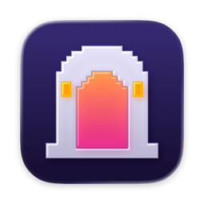

# M(a)C Dungeons II

[English](README.md) · **한국어**

M(a)C Dungeons II는 **Minecraft Dungeons II**(Minecraft Launcher / Microsoft Store판)를 Apple Silicon Mac에서 실행합니다. 게임을 구매한 Microsoft 계정으로 로그인하면 게임을 내려받아 실행합니다. Wine(CrossOver 26.3), [DXMT](https://github.com/3Shain/dxmt), [Flightdeck](https://github.com/marselnenaj/flightdeck-msfs-2024-linux-xbox) 기반 GDK 런타임, [xodus](https://github.com/xodus-gaming/xodus)로 만들었습니다.

비공식 프로젝트이며 Mojang, Microsoft, Xbox와 관련이 없습니다.

## 기능

- 기존 영웅으로 온라인 플레이
- 설정과 저장 (Mac에 저장)
- 게임 영상, 블루투스 Xbox 컨트롤러
- 일시 정지·이어 받기가 되는 다운로드
- 선택: Mac용 Minecraft Launcher에서 게임 시작

## 시스템 요구 사항

- Apple Silicon Mac, Rosetta 2
- macOS 14 이상
- 여유 공간 약 25GB

## 설치

[Releases](../../releases/latest)에서 `MaC-Dungeons-II.dmg`를 받아 앱을 Applications로 끌어다 놓습니다.

## 문제가 있을 때

M4 MacBook(macOS 27)에서 시험했습니다. 게임 업데이트로 동작이 깨질 수 있습니다. `~/Library/Application Support/M(a)C Dungeons II/logs`의 로그와 함께 [이슈](../../issues)를 남겨 주세요.

## 개발

- [동작 방식](docs/architecture.ko.md)
- [빌드](docs/building.ko.md)

## 감사

- [xodus](https://github.com/xodus-gaming/xodus) — Microsoft 로그인, 라이선스, 패키지 다운로드
- [Flightdeck](https://github.com/marselnenaj/flightdeck-msfs-2024-linux-xbox) — GDK 런타임
- [mcd2-crossover](https://github.com/Wanzho/mcd2-crossover)(Wanzho) — XCurl·Wine 수정, XUser 구조
- [WineGDK](https://github.com/Sightem/WineGDK), [GDK-Proton](https://github.com/LukasPAH/GDK-Proton-Custom) — GDK 빌트인
- [DXMT](https://github.com/3Shain/dxmt) — Direct3D 11 → Metal
- CodeWeavers, Wine 프로젝트

## 라이선스

MIT. 함께 배포하는 구성 요소는 각자의 라이선스를 따릅니다([app/NOTICE.md](app/NOTICE.md)). xodus와 Flightdeck 수정 사항은 [MaC-Dungeons-II](https://github.com/MaC-Dungeons-II) 포크에 있습니다.

Minecraft, Minecraft Dungeons는 각 소유자의 상표입니다.
